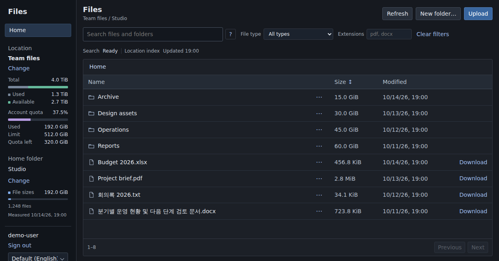
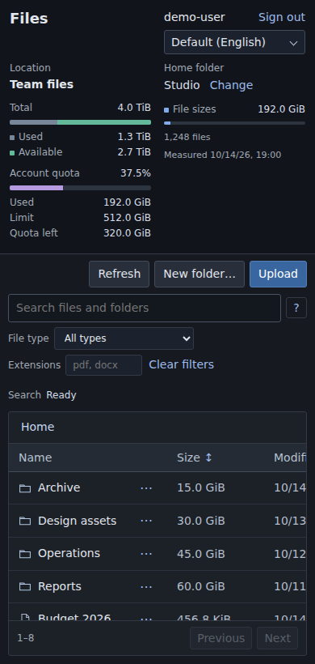

# SSUD UI

**A compact dark workspace style for file tools, settings, and operational dashboards.**

SSUD UI packages the design of Samba Search, Upload & Download as a portable Agent Skill. It includes reusable CSS tokens, components, and live examples.



*The SSUD application on desktop, rendered with a sample account, file list, and storage figures.*

## The SSUD style

The design was deliberately guided to minimize the generic, templated feel often associated with AI-generated interfaces. SSUD UI aims for a natural, purpose-built work tool, with layout and copy shaped by actual file operations. See the [design intent and practical guidance](skills/ssud-ui/references/DESIGN.md#design-intent).

- **Quiet surfaces.** Charcoal panels, thin borders, small corner radii, and muted metadata keep the focus on files and controls.
- **Dense, readable data.** Compact rows, fixed table headers, and aligned sizes and dates make lists easy to scan.
- **Clear actions.** Blue highlights Upload and download links. Row menus keep secondary commands near each file.
- **Storage at a glance.** Short bars summarize location capacity, account quota, and home-folder usage.



*The SSUD application on a phone, rendered with the same sample data.*

The kit adapts these design patterns into reusable examples, including collapsible panels and filters for narrow screens. Open the [component catalogue](skills/ssud-ui/assets/kit/index.html) in a browser to try them.

## Use the skill

Clone the repository from GitHub.

```sh
git clone https://github.com/pathcosmos/ssud-ui.git
```

Copy the entire [skills/ssud-ui](skills/ssud-ui) directory into your agent's skill directory. For Codex, use `~/.agents/skills/` for all projects on this device or `.agents/skills/` in a project root. For example, from the directory where you ran the clone command:

```sh
mkdir -p ~/.agents/skills
cp -R ssud-ui/skills/ssud-ui ~/.agents/skills/
```

In Codex, invoke it with `$ssud-ui`. For Claude Code, place the entire folder in `~/.claude/skills/` for personal use or `.claude/skills/` for project use, then invoke `/ssud-ui`. In a client that accepts files as context, attach the [design guide](skills/ssud-ui/references/DESIGN.md), [CSS tokens](skills/ssud-ui/assets/tokens.css), and any relevant example files.

## Browse the kit

Open any page directly in a browser. Keep the asset folder structure intact.

| Page | Try |
| --- | --- |
| [Component catalogue](skills/ssud-ui/assets/kit/index.html) | Open Copy HTML for markup, try the responsive Filters disclosure, and navigate tabs with arrow keys. |
| [Files and search](skills/ssud-ui/assets/example/index.html) | Search for `"final report"` or `회의`, jump to a folder, and return to the same results. |
| [Settings form](skills/ssud-ui/assets/kit/settings.html) | Submit the initial form, follow the error links, then correct the fields and save. |
| [Transfer queue](skills/ssud-ui/assets/kit/transfers.html) | Add a sample, confirm the simulated upload, and retry the failed transfer. |

The examples use local, in-memory data. Reload to reset them. Resize the browser to see the phone, tablet, and desktop layouts.

## Asset inventory

### Shared styles and behavior

| Asset | What it provides |
| --- | --- |
| [tokens.css](skills/ssud-ui/assets/tokens.css) | Colors, type sizes, spacing, borders, focus colors, storage capacity colors, sidebar width, and row height under the `ssud-ui` scope. |
| [components.css](skills/ssud-ui/assets/components.css) | Buttons, fields, validation states, navigation, tables, action menus, responsive dialogs, workspace layout, and adaptive columns. |
| [disclosures.js](skills/ssud-ui/assets/disclosures.js) | Expands and collapses the workspace rail and filters at configured widths. Updates `aria-expanded` and preserves manual choices and existing field values during resizing. |
| [kit/pages.css](skills/ssud-ui/assets/kit/pages.css) | Page-specific layouts for the settings form, transfer queue, and catalogue. |

### Component catalogue

Open **Copy HTML** within each section to select its example markup. Use the named script or full page when you need the example's interactive behavior.

| Catalogue section | Assets shown |
| --- | --- |
| [Buttons and links](skills/ssud-ui/assets/kit/index.html#buttons) | Primary, secondary, destructive, icon-only and disabled buttons, links, and status feedback. |
| [Inputs and field errors](skills/ssud-ui/assets/kit/index.html#fields) | Text and number inputs, select menus, checkboxes, radio groups, text areas, and field-level validation messages. |
| [Navigation](skills/ssud-ui/assets/kit/index.html#navigation) | Sidebar, breadcrumbs, and keyboard-operated tabs. |
| [Lists and search](skills/ssud-ui/assets/kit/index.html#browse) | Search, type filtering, sortable table, pagination, and row actions. |
| [Empty states, errors and progress](skills/ssud-ui/assets/kit/index.html#feedback) | Empty states, recoverable errors, and determinate or indeterminate progress. |
| [Dialogs and files](skills/ssud-ui/assets/kit/index.html#overlays) | File selection, a confirmation dialog, and focus return. |
| [Responsive layout](skills/ssud-ui/assets/kit/index.html#responsive) | Adaptive columns and a filter disclosure that retains its selection on resize. |

### Example implementation and skill files

| Files | Role |
| --- | --- |
| [example/index.html](skills/ssud-ui/assets/example/index.html) · [app.js](skills/ssud-ui/assets/example/app.js) · [style.css](skills/ssud-ui/assets/example/style.css) | File workspace with fixture data, folder navigation, type and extension filters, sorting, results restoration, storage indicators, and simulated transfers. |
| [kit/settings.html](skills/ssud-ui/assets/kit/settings.html) · [settings.js](skills/ssud-ui/assets/kit/settings.js) | Settings form with field errors, a linked error summary, and simulated save feedback. |
| [kit/transfers.html](skills/ssud-ui/assets/kit/transfers.html) · [transfers.js](skills/ssud-ui/assets/kit/transfers.js) | File selection and drop, upload confirmation, progress, simulated failure and retry. |
| [kit/index.html](skills/ssud-ui/assets/kit/index.html) · [catalogue.js](skills/ssud-ui/assets/kit/catalogue.js) | Live component examples, selectable HTML snippets, keyboard tabs, and sample-table interactions. |
| [SKILL.md](skills/ssud-ui/SKILL.md) · [openai.yaml](skills/ssud-ui/agents/openai.yaml) | Skill entry point and Codex display metadata. |
| [DESIGN.md](skills/ssud-ui/references/DESIGN.md) | Visual guidelines, responsive patterns, accessibility, and browser verification. |

## Reuse in another project

1. Load `tokens.css` first, followed by `components.css`, and add `ssud-ui` to the workspace root.
2. Copy the required markup from the catalogue. Include `disclosures.js` with `defer` for elements using `data-disclosure` and `aria-controls`.
3. Use the example page scripts as references when connecting your own data, permissions, and transfer operations. See the [responsive workspace guide](skills/ssud-ui/references/DESIGN.md#responsive-workspace) for a complete disclosure example.

The initial design baseline is SSUD commit `7392b71`.
